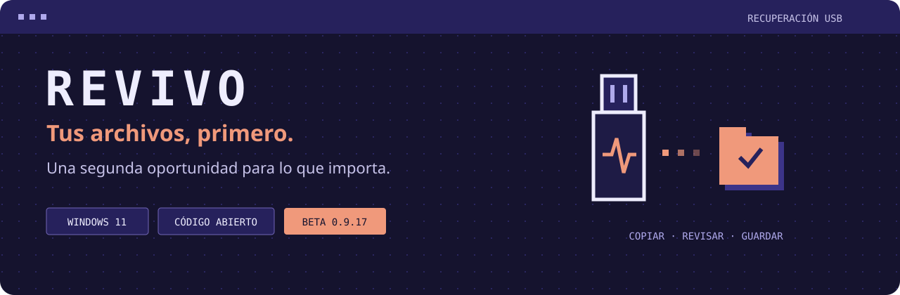
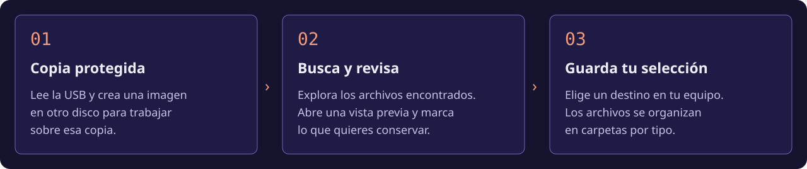

<p align="center">
  
</p>

<p align="center">
  <a href="https://revivo.digital"><strong>Visitar la web</strong></a> ·
  <a href="BUILD.md">Compilar el programa</a> ·
  <a href="https://revivo.digital/#feedback">Enviar feedback</a> ·
  <a href="https://github.com/ivanovich5/Revivo/issues">Reportar un problema</a>
</p>

<p align="center">
  <strong>Una herramienta para recuperar archivos de memorias USB dañadas o RAW.</strong><br>
  Crea una copia protegida, revisa lo encontrado y elige qué guardar en tu computadora.
</p>

> [!NOTE]
> **REVIVO-USB 1.0.2 está disponible.** Descarga el instalador, el código fuente correspondiente y las huellas SHA-256 desde [revivo.digital](https://revivo.digital/#descarga). Este repositorio contiene la aplicación, la web y el servicio de feedback. El instalador actual no tiene firma digital; no afirmamos aprobación de ningún proveedor de firma.

## Una segunda oportunidad para tus archivos

REVIVO combina la recuperación de datos con un flujo pensado para acompañarte: elegir la memoria, buscar en una copia y revisar los resultados antes de guardar tu selección.

| 🛡️ Trabajar sobre una copia | 🔎 Revisar antes de guardar |
| :--- | :--- |
| Lectura de la USB y creación de una imagen sector por sector. La recuperación se realiza sobre esa copia. | Vistas previas locales de formatos compatibles, disponibles con doble clic sobre el nombre. |
| **📁 Elegir y organizar** | **🩺 Entender el estado de la memoria** |
| Selección individual o por lote, filtros por tipo y estado, y guardado en carpetas por tipo. | Diagnóstico de lectura con información sobre errores y demoras, sin afirmar que la USB sea fiable. |

## De la USB a tu computadora



1. **Elige la memoria y el destino.** REVIVO prepara una copia para proteger el original.
2. **Revisa lo encontrado.** Explora los resultados, abre las vistas disponibles y marca tus archivos.
3. **Guarda lo que importa.** Elige una carpeta en tu computadora y sigue el progreso del guardado.

Las imágenes de esta página son ilustraciones del flujo, no capturas ni resultados de una recuperación real.

## Antes de empezar

> [!IMPORTANT]
> Si necesitas recuperar información, **no formatees ni guardes archivos nuevos en la memoria**. El proceso puede tardar desde minutos hasta varias horas y requiere espacio para la imagen, los archivos extraídos y las vistas previas.

- **Encontrado no significa íntegro.** Una comprobación estructural no garantiza contenido completo.
- **Nombres y carpetas pueden perderse.** Depende de la información que sobreviva en el sistema de archivos.
- **El diagnóstico tiene límites.** Una lectura correcta no certifica escritura, retención ni fiabilidad futura.
- **Reutilizar es opcional.** El borrado está separado del rescate y requiere verificaciones y confirmación explícita.

## Para quienes quieren construir con REVIVO

**Windows 11 · .NET 8 / WPF · Python · HTML / CSS / JavaScript**

La aplicación coordina motores externos, validación y vistas previas. La web funciona como sitio estático; su formulario utiliza un receptor privado de feedback.

```text
Revivo/
├── src/          Aplicación de escritorio y auxiliares
├── scripts/      Validación, vistas y preparación de motores
├── tests/        Pruebas y generadores de imágenes sintéticas
├── installer/    Configuración de Inno Setup
├── web/          Página web pública
├── feedback/     Receptor privado de comentarios
└── docs/images/  Recursos visuales de este README
```

**[Guía de compilación →](BUILD.md)** · **[Dependencias y licencias →](THIRD_PARTY.md)**

Publicar el proyecto WPF no genera por sí solo un instalador completo. Los motores y el runtime Python se preparan aparte. El repositorio no incluye instaladores, imágenes de USB, archivos recuperados, credenciales ni bases de datos de usuarios.

## Ayúdanos a mejorar

| Quiero… | Dónde empezar |
| :--- | :--- |
| Contar cómo me fue o sugerir algo | [Formulario de feedback](https://revivo.digital/#feedback) |
| Reportar un problema reproducible | [Issues de GitHub](https://github.com/ivanovich5/Revivo/issues) |
| Contribuir con código o documentación | [Guía para contribuir](CONTRIBUTING.md) |

**Cuida tus datos:** no adjuntes documentos recuperados, imágenes de memorias, claves, números de serie ni información personal. Para reproducir errores, utiliza datos sintéticos.

## Código abierto, con responsabilidades claras

El código propio de REVIVO se ofrece bajo **[AGPL-3.0-only](LICENSE.txt)**. Los motores, bibliotecas y fuentes conservan sus licencias: consulta [THIRD_PARTY.md](THIRD_PARTY.md). Silkscreen se incluye bajo OFL 1.1.

Este repositorio no incorpora los paquetes binarios de terceros ni afirma ser una entrega completa de sus fuentes correspondientes.

---

<p align="center"><strong>REVIVO</strong><br>Tus archivos, primero.<br><a href="https://revivo.digital">revivo.digital</a></p>
